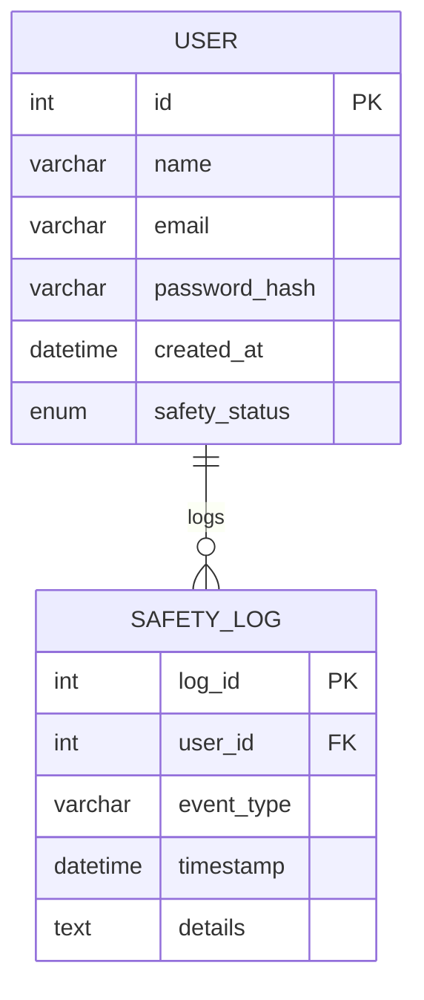

# Entity Relationship Diagram

## Entities
- **User**
  - `id` (INT) – Primary Key
  - `name` (VARCHAR) – User's full name
  - `email` (VARCHAR) – Unique email address
  - `password_hash` (VARCHAR) – Hashed password
  - `created_at` (DATETIME) – Account creation timestamp
  - `safety_status` (ENUM) – Current safety status (e.g., *safe*, *warning*, *danger*) – *Preserved information: “User Safety: safe”*

- **SafetyLog**
  - `log_id` (INT) – Primary Key
  - `user_id` (INT) – Foreign Key referencing **User**
  - `event_type` (VARCHAR) – Type of safety event
  - `timestamp` (DATETIME) – When the event occurred
  - `details` (TEXT) – Detailed description of the event

## Mermaid ERD
